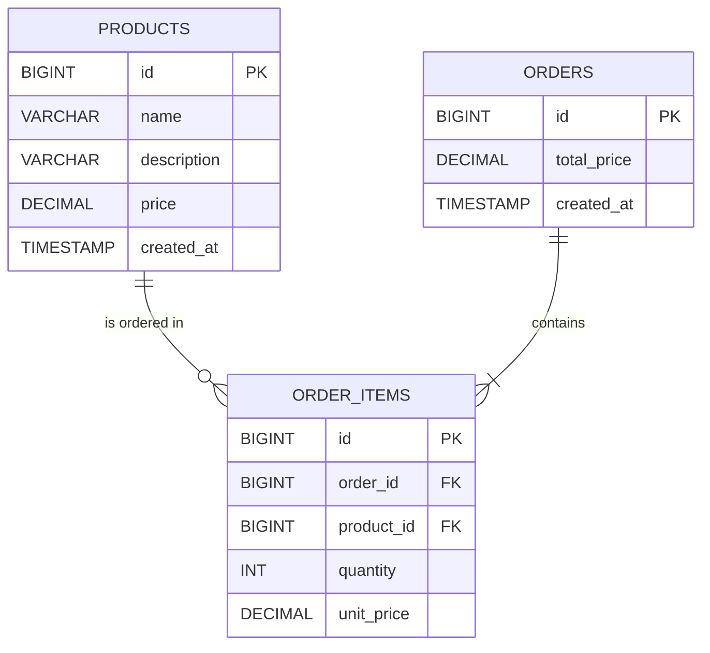

# Order Management Service

A small Spring Boot microservice that manages **Products** and **Orders**.

- Java 17, Spring Boot 4.0, Maven
- H2 in-memory database, Spring Data JPA
- HTTP Basic authentication on every endpoint (Spring Security)
- OpenAPI 3 / Swagger UI
- Unit tests and full-stack integration tests

## Contents

- [Run the service](#run-the-service)
- [Try it](#try-it)
- [Run the tests](#run-the-tests)
- [API](#api)
- [Project structure](#project-structure)
- [Database schema](#database-schema)
- [Design notes](#design-notes)
- [Assumptions](#assumptions)

## Run the service

Prerequisite: **JDK 17 or newer**. Maven is not required; the Maven wrapper downloads it.

```bash
./mvnw spring-boot:run          # macOS / Linux
mvnw.cmd spring-boot:run        # Windows
```

The service starts on <http://localhost:8080>.

| What | Where |
|---|---|
| Swagger UI | <http://localhost:8080/swagger-ui.html> |
| OpenAPI document | <http://localhost:8080/v3/api-docs> |
| Username / password | `admin` / `admin123` |

All endpoints require authentication, including Swagger UI: the browser will ask for the
username and password when you open it. Inside Swagger UI, click **Authorize** and enter the
same credentials before using *Try it out*.

The credentials are demo defaults. Override them with environment variables:

```bash
API_USERNAME=someone API_PASSWORD=something-long ./mvnw spring-boot:run
```

To build and run a jar instead:

```bash
./mvnw clean package
java -jar target/order-management-service-0.1.0-SNAPSHOT.jar
```

## Try it

```bash
# Create two products
curl -u admin:admin123 -H "Content-Type: application/json" \
  -d '{"name": "Keyboard", "description": "Mechanical", "price": 499.99}' \
  http://localhost:8080/api/v1/products

curl -u admin:admin123 -H "Content-Type: application/json" \
  -d '{"name": "Mouse", "price": 150.00}' \
  http://localhost:8080/api/v1/products

# Create an order: 2 keyboards and 1 mouse -> totalPrice 1149.98
curl -u admin:admin123 -H "Content-Type: application/json" \
  -d '{"items": [{"productId": 1, "quantity": 2}, {"productId": 2, "quantity": 1}]}' \
  http://localhost:8080/api/v1/orders

# An order with an unknown product is rejected -> 422
curl -u admin:admin123 -H "Content-Type: application/json" \
  -d '{"items": [{"productId": 1}, {"productId": 99}]}' \
  http://localhost:8080/api/v1/orders

# Read
curl -u admin:admin123 http://localhost:8080/api/v1/orders/1
curl -u admin:admin123 "http://localhost:8080/api/v1/orders?page=0&size=20"
```

## Run the tests

```bash
./mvnw test
```

This runs everything (about 40 tests, a few seconds):

| Kind | Where | What it covers |
|---|---|---|
| Unit | `domain/OrderTest` | Total calculation and price snapshot on the `Order` aggregate. No Spring. |
| Unit | `service/*ServiceTest` | Service logic with Mockito: missing products reject the order, duplicates merge, not-found cases. |
| Unit | `logging/RequestLoggingFilterTest` | Request id handling. |
| Integration (DB) | `repository/OrderRepositoryTest` | Entity mappings against the real `schema.sql`. |
| Integration (API + DB) | `api/*IntegrationTest` | The whole application through HTTP with real Basic credentials and H2: authentication, validation, error responses, persistence, pagination, caching. |

## API

Base path: `/api/v1`. JSON in and out.

| Method | Path | Description | Success | Errors |
|---|---|---|---|---|
| `POST` | `/products` | Create a product | `201` + `Location` | `400` |
| `GET` | `/products/{id}` | Get a product | `200` | `404` |
| `GET` | `/products?page=0&size=20` | List products (paginated) | `200` | `400` |
| `POST` | `/orders` | Create an order | `201` + `Location` | `400`, `422` |
| `GET` | `/orders/{id}` | Get an order | `200` | `404` |
| `GET` | `/orders?page=0&size=20` | List orders (paginated) | `200` | `400` |

Any request without valid credentials returns `401`.

Create order request and response:

```json
{ "items": [ { "productId": 1, "quantity": 2 }, { "productId": 2, "quantity": 1 } ] }
```

```json
{
  "id": 1,
  "items": [
    { "productId": 1, "productName": "Keyboard", "quantity": 2, "unitPrice": 499.99, "lineTotal": 999.98 },
    { "productId": 2, "productName": "Mouse", "quantity": 1, "unitPrice": 150.00, "lineTotal": 150.00 }
  ],
  "totalPrice": 1149.98,
  "createdAt": "2026-10-11T17:56:41.231939Z"
}
```

Errors use the standard `application/problem+json` format (RFC 9457). A rejected order lists
every product id that could not be found:

```json
{
  "title": "Order rejected",
  "status": 422,
  "detail": "Order rejected: products not found for ids [7, 99]",
  "instance": "/api/v1/orders",
  "missingProductIds": [7, 99]
}
```

## Project structure

A conventional layered structure, one package per layer. Dependencies only point downwards:
controller -> service -> repository -> domain.

```
com.elisiuslegodi.orders
├── controller   HTTP only: routing, status codes, request validation
├── service      Business logic and transaction boundaries
├── repository   Spring Data JPA repositories
├── domain       JPA entities (Product, Order, OrderItem) and their invariants
├── dto          Request/response records - the public API contract
├── exception    Domain exceptions and the single global error handler
├── logging      Request logging filter (request id, method, path, status, duration)
└── config       Security, OpenAPI and cache configuration
```

## Database schema

The schema is defined in [`src/main/resources/schema.sql`](src/main/resources/schema.sql).



Decisions:

- **`order_items` join table with its own columns.** Orders and products are many-to-many, but
  the relationship carries data: `quantity` and `unit_price`. A plain two-column join table
  (JPA `@ManyToMany`) cannot hold either.
- **`unit_price` is a snapshot.** It is copied from the product when the order is placed, so
  changing a product's price later does not change what a past order cost.
- **`total_price` is stored.** It is calculated once, when the order is created, from the
  snapshot prices. Storing it makes reads and listing cheap and keeps the amount the customer
  was charged as a fact, rather than something recomputed on every read.
- **Constraints live in the database**, not only in Java: foreign keys on both sides of
  `order_items`, `UNIQUE (order_id, product_id)` (one line per product per order), and `CHECK`
  constraints for a positive quantity and a non-negative price.
- **`DECIMAL(19,2)` / `BigDecimal` for money**, never floating point.
- **`ON DELETE CASCADE` from orders to items**; no cascade from products, so a product that has
  been ordered cannot be deleted from under an order.
- **Table is called `orders`** because `ORDER` is a reserved word in SQL.
- **Explicit `schema.sql` with `ddl-auto=validate`** rather than letting Hibernate generate the
  tables. The DDL is readable and reviewable, and the application fails at startup if the
  entities and the schema ever disagree. With a persistent database I would use versioned
  Flyway migrations instead; for an in-memory database that is recreated on every start, a
  single script does the same job with one less dependency.

## Design notes

**Layering.** Controllers contain no business logic and services know nothing about HTTP.
Entities are never serialised directly: request and response bodies are separate record DTOs,
so the API contract and the persistence model can change independently and no lazy-loading or
over-posting problems leak into the API. `open-in-view` is disabled so all database access
happens inside service transactions.

**Where the business rules live.** `OrderService.createOrder` validates that every product
exists (one `findAllById` query, not one per item) and rejects the order with *all* missing ids
at once. The price calculation lives on the `Order` aggregate (`addItem`), so the total cannot
get out of step with the items and the logic is unit-tested without Spring. Order creation is
one transaction: either the order and all its items are saved, or nothing is.

**Error for a missing product: `422`.** The request is well-formed and the `/orders` resource
exists, so `404` would be misleading (it normally means the URL is wrong) and `400` suggests a
syntax problem. `422 Unprocessable Content` says the body was understood but cannot be acted
on. `GET` on an unknown id returns `404`.

**Security.** HTTP Basic with a single in-memory user and a BCrypt-hashed password. Basic was
chosen over an API-key header because Spring Security supports it natively (no custom filter)
and every client, including Swagger UI, already speaks it. The API is stateless, so CSRF
protection is disabled. Nothing is public: the challenge asks for all endpoints to be
authenticated, so the docs are too. Basic credentials are only safe over HTTPS; in a real
deployment TLS would be terminated in front of the service.

**Logging.** One line per API request when it completes (method, path, status, duration), an
`Order created` event with id, item count and total, a `WARN` without stack trace for rejected
requests, and an `ERROR` with stack trace only for unexpected failures. Every line carries a
request id (accepted from `X-Request-Id` or generated, and echoed in the response) so the lines
for one request can be found together. Request bodies, headers and query strings are not logged.

**Pagination (stretch).** List endpoints take `page` and `size` (default 20, max 100) with a
fixed sort by id and return `content`, `page`, `size`, `totalElements`, `totalPages`.

**Caching (stretch).** `GET /products/{id}` is cached in-process with Caffeine (1000 entries,
10 minutes) through Spring's cache abstraction. Products cannot be updated or deleted through
this API, so entries cannot go stale. The cache is per instance; with several instances and
mutable products it would move to a shared cache such as Redis.

**No Lombok or mapping library.** Records cover the DTOs, and with three small entities the
explicit constructors and `from(...)` mappers are shorter than the configuration would be.

## Assumptions

- An order item has a `quantity`; it defaults to 1 if omitted, and must be between 1 and 10 000.
- The same product listed twice in one request is merged into one line with the summed quantity.
- Prices have at most two decimal places and a single, implicit currency.
- Orders are immutable once created; there is no status, update or cancel flow, and no stock
  tracking, because the brief does not ask for them.
- Products cannot be updated or deleted (not in the brief).
- One set of credentials is enough; there are no roles.
- Data is lost on restart, as expected for an in-memory database.
